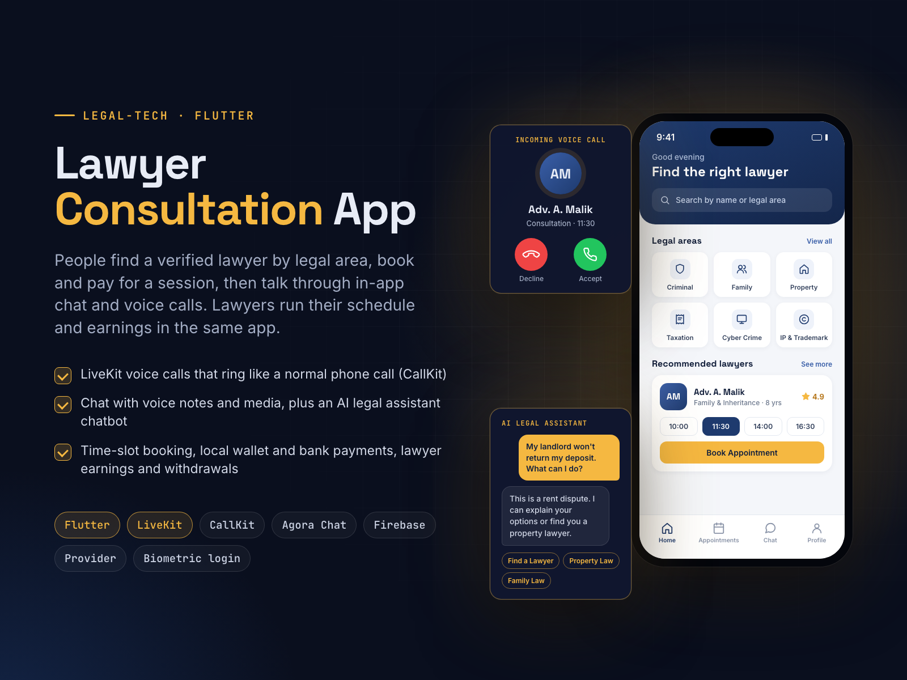

# Lawyer Consultation App

**Booking, Payments, Chat & Voice Calls**

**Goal:** help people find a verified lawyer by legal area and consult them from their phone.

**Solution:** one Flutter app for clients and lawyers. Clients pick a legal area, book a time slot, pay by wallet or bank transfer, then talk through in-app chat (voice notes, photos) and LiveKit voice calls that ring like a normal phone call via CallKit. An AI legal assistant answers first questions. Lawyers verify their ID, manage their schedule and track earnings and withdrawals.

**Result:** the whole consultation flow, from search to paid call, in one app.

| | |
|---|---|
| **My role** | Lead Flutter developer |
| **Skills** | Flutter, Mobile App Development, VoIP, Chat & Messaging Software, Push Notifications |

## About this repository

This is a showcase repository. It contains the project poster and the poster's own HTML/CSS source in [`poster/`](poster/).
The app was built for a client, so its source code and the client's name are not public.

To re-render the poster, open `poster/index.html` in Chrome at 1600×1200, or run `poster/render.sh` on macOS.

More of my work: **https://ahsanrazapk.github.io**
